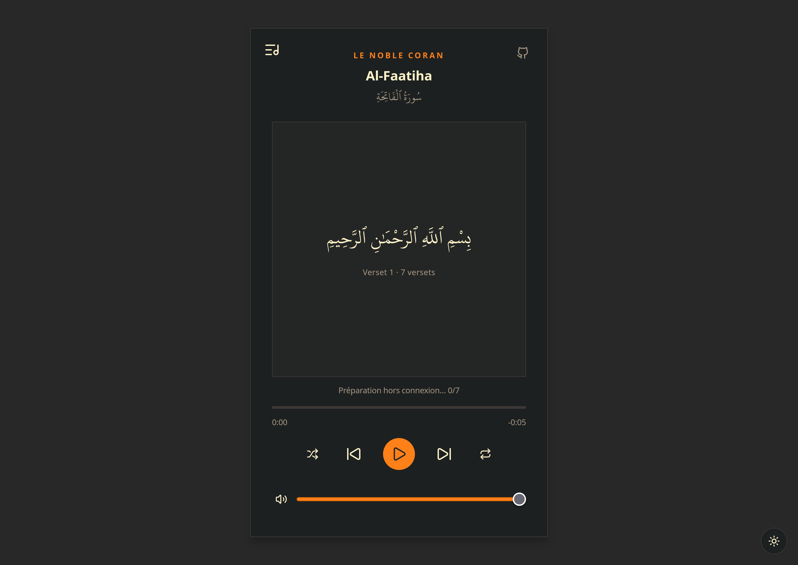

# Quran - MP3

Quran - MP3 est un lecteur du Coran utilisable sur ordinateur et sur mobile. Il affiche le texte arabe et permet d’écouter la récitation en français, verset par verset.

## Aperçu



## Fonctionnalités

- Parcourir les 114 sourates et choisir un verset avec les commandes du lecteur.
- Lire, mettre en pause, avancer ou reculer, régler le volume et déplacer la lecture.
- Activer la lecture aléatoire et la répétition d’un verset ou de la sourate.
- Choisir un thème clair ou sombre ; le choix est mémorisé sur l’appareil.
- Installer l’application depuis un navigateur compatible.
- Préparer automatiquement les audios d’une sourate pour une écoute hors connexion, lorsqu’elle est ouverte avec une connexion Internet.

## Utilisation hors connexion

À l’ouverture d’une sourate en ligne, l’application charge ses données puis met en cache les audios de ses versets. Un indicateur affiche la progression et signale quand la sourate est prête hors connexion. Les données de sourate consultées sont également mises en cache.

Le cache est conservé par le navigateur sur l’appareil. Il peut être supprimé par les réglages du navigateur ou si celui-ci libère de l’espace. Ouvre chaque sourate avec Internet avant de compter l’écouter hors connexion.

## Lancer le projet en local

Prérequis : Node.js et pnpm.

```bash
pnpm install
pnpm dev
```

Vite affiche l’adresse locale à ouvrir dans le navigateur.

## Vérification et aperçu de production

```bash
pnpm build
pnpm preview
```

La commande `pnpm lint` lance Oxlint.

## Commandes clavier

| Touche | Action |
| --- | --- |
| `Espace` | Lecture ou pause |
| `←` / `→` | Verset précédent ou suivant |
| `↑` / `↓` | Augmenter ou réduire le volume |
| `M` | Activer ou couper le son |

## Sources des données

Les données des sourates et le texte arabe sont récupérés depuis [AlQuran Cloud](https://alquran.cloud/). Les récitations audio en français sont fournies par leur édition `fr.leclerc` et diffusées depuis le CDN Islamic Network. Une connexion Internet est nécessaire pour récupérer les données et audios qui ne sont pas encore en cache.
