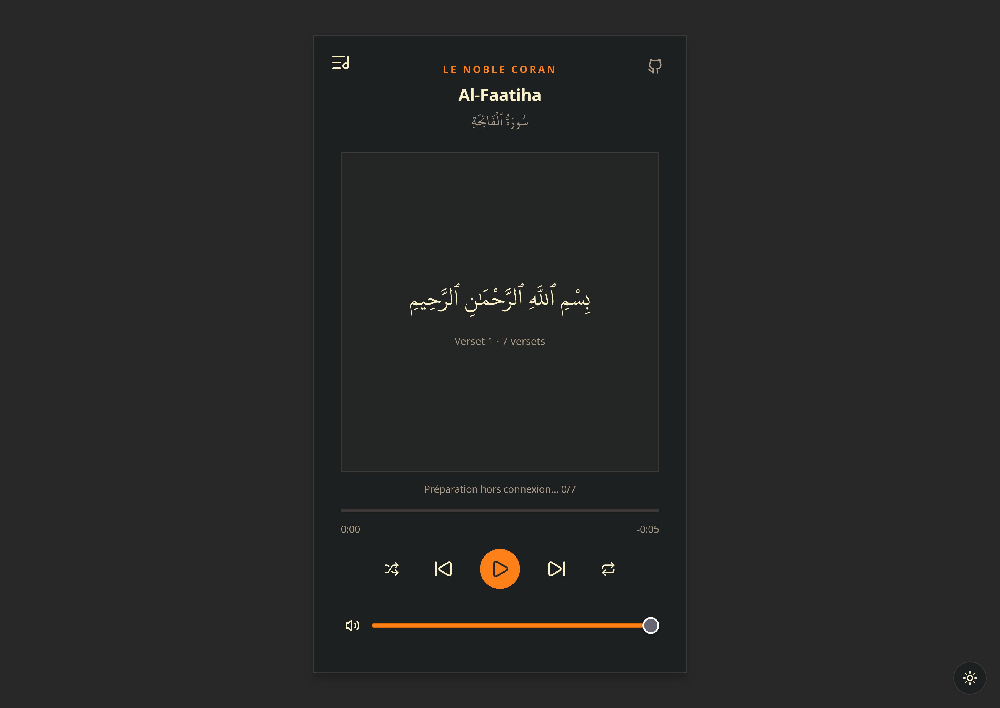

# Quran - MP3

Quran - MP3 est un lecteur du Coran utilisable sur ordinateur et sur mobile. Il affiche le texte arabe et permet d’écouter la récitation en français, verset par verset.

## Aperçu



## Fonctionnalités

- Parcourir les 114 sourates et choisir un verset avec les commandes du lecteur.
- Lire, mettre en pause, avancer ou reculer et déplacer la lecture.
- Activer la lecture aléatoire et la répétition d’un verset ou de la sourate.
- Régler la vitesse de lecture de 0,5× à 2× et revenir à 1× d’un bouton ; le réglage est mémorisé sur l’appareil.
- Enregistrer des versets dans des signets et y revenir rapidement.
- Rechercher un verset par son numéro ou par son texte dans la sourate en cours.
- Définir une boucle entre deux versets avec « Boucle » (le premier appui choisit le début, le second la fin).
- Programmer l’arrêt de la lecture avec le minuteur de sommeil, à durée fixe ou à la fin du verset.
- Afficher en même temps le texte arabe et la traduction choisie (« Afficher aussi le texte arabe » dans les réglages).
- Retrouver la dernière sourate, le verset et la position de lecture sur cet appareil.
- Choisir un thème clair ou sombre ; le choix est mémorisé sur l’appareil.
- Installer l’application depuis un navigateur compatible.
- Télécharger manuellement les audios d’une sourate pour une écoute hors connexion.

## Utilisation hors connexion

Les données des sourates consultées sont mises en cache automatiquement. Pour préparer les audios, ouvre une sourate avec Internet puis choisis « Télécharger pour hors connexion ». Un indicateur affiche la progression et signale quand la sourate est prête. Les audios déjà présents dans le cache ne sont pas téléchargés une seconde fois.

Le bouton « Stockage » du lecteur liste les sourates téléchargées, indique l’espace utilisé et permet de supprimer leurs audios. Le cache est conservé par le navigateur sur l’appareil. Il peut être supprimé par les réglages du navigateur ou si celui-ci libère de l’espace. Ouvre chaque sourate avec Internet avant de compter l’écouter hors connexion.

## Lancer le projet en local

Prérequis : Node.js et pnpm.

```bash
pnpm install
pnpm dev
```

Vite affiche l’adresse locale à ouvrir dans le navigateur.

## Vérification et aperçu de production

```bash
pnpm build
pnpm preview
```

La commande `pnpm lint` lance Oxlint.

## Commandes clavier

| Touche | Action |
| --- | --- |
| `Espace` | Lecture ou pause |
| `←` / `→` | Verset précédent ou suivant |

## Sources des données

Les textes et les noms de sourates proviennent de [QuranEnc.com](https://quranenc.com/). Les récitations arabes et la voix française de Youssouf Leclerc sont diffusées par le CDN Islamic Network (AlQuran Cloud).

- Récitations audio (CDN Islamic Network) : arabe — Saʿūd ash-Shuraym, Abū Bakr ash-Shāṭirī, Maḥmūd Khalīl al-Ḥuṣary (dont la version *mujawwad*), ʿAbd ar-Raḥmān as-Sudays, Māher al-Muʿayqlī, ʿAlī al-Ḥudhayfī, ʿAbdullāh Baṣfar, Ḥānī ar-Rifāʿī et Ayman Suwaid ; français — Youssouf Leclerc (`fr.leclerc`). La traduction française lue de Rachid Maach (`french_rashid`) provient de QuranEnc.
- Textes affichés : texte arabe othmanien, traduction française de Rachid Maach ou du Centre International Nûr (`french_montada`, QuranEnc) ; traduction de Mohammed Hamidullah (`fr.hamidullah`, AlQuran Cloud), qui correspond à la récitation française de Youssouf Leclerc.
- Les métadonnées des sourates non fournies par QuranEnc sont embarquées dans l’application.

Les noms et versions des traductions sont indiqués dans les réglages, conformément aux conditions d’attribution de QuranEnc. Une connexion Internet est nécessaire pour récupérer les données et audios qui ne sont pas encore en cache.
